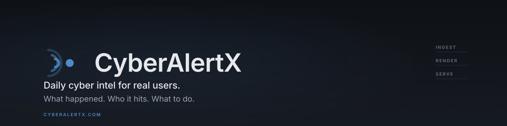
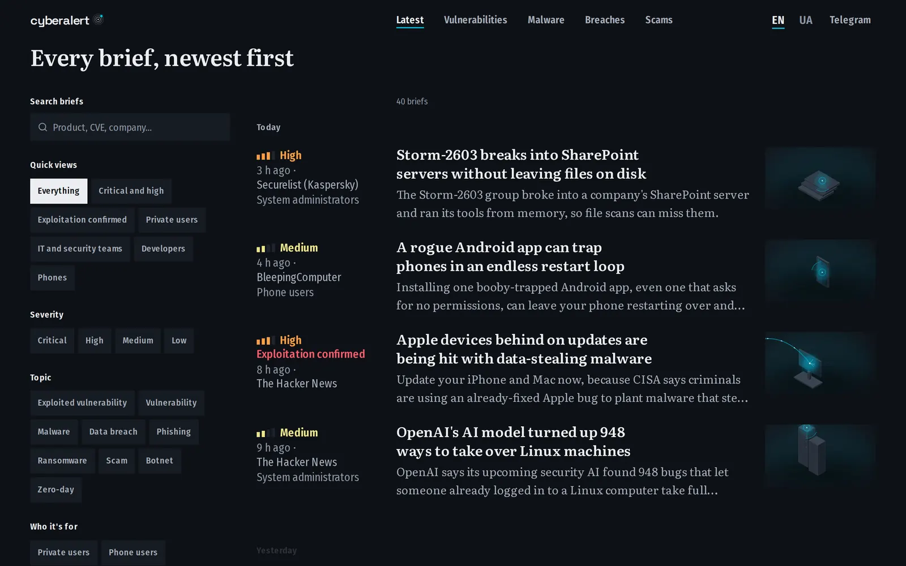
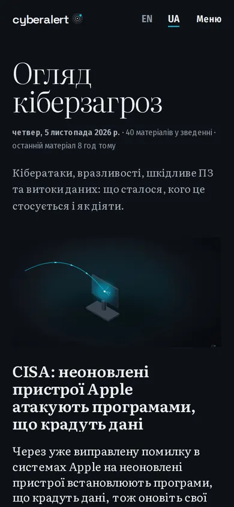
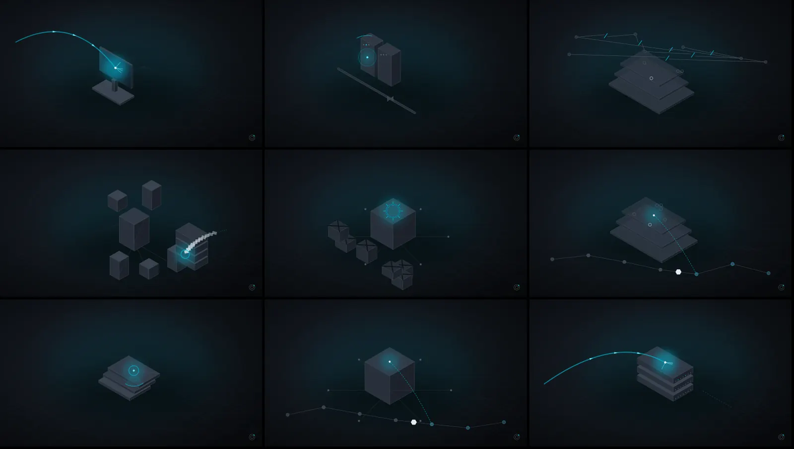
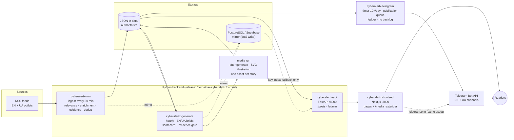
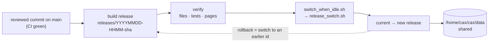

<p align="center">
  
</p>

<p align="center">
  <a href="https://github.com/vyahello/cyberalertx/actions/workflows/ci.yml"></a>
  
  
  <a href="LICENSE"></a>
</p>

<p align="center">
  <b><a href="https://cyberalertx.com">cyberalertx.com</a></b> ·
  <a href="docs/architecture.md">Architecture</a> ·
  <a href="docs/operations/OPERATIONS.md">Operations</a> ·
  <a href="docs/README.md">All docs</a>
</p>

# CyberAlertX

**A bilingual cyber threat briefing: what happened, who is affected and what to do — in English and Ukrainian.**

CyberAlertX reads trusted security sources, keeps what matters to ordinary
users and IT teams, and turns each story into a short, sourced brief. Evidence
(is it exploited? was data taken?) is reported separately from severity, so a
critical-sounding headline never becomes a claim the source does not make.

<p align="center">
  
</p>
<p align="center"><sub>Homepage, English edition (local staging build of the production code, public articles).</sub></p>

## What it does

| | |
|---|---|
| **Collects** | RSS from BleepingComputer, The Hacker News, Krebs on Security, Securelist, CISA and Ukrainian outlets (itc.ua, ain.ua, dev.ua, dou.ua) every 30 minutes |
| **Filters and enriches** | relevance, category, affected platforms, audience, action priority, source credibility, story deduplication across outlets |
| **Checks evidence** | exploitation, compromise, campaign status, sponsorship and open questions, from the source text only — kept apart from severity |
| **Writes** | one brief per story in EN and UA (Claude), with a deterministic rule-based fallback; CVEs, numbers and attribution are checked against the source |
| **Reviews** | a quality scorecard and an evidence gate flag doubtful briefs for an editor (`/admin/review`); production runs in `flag` mode |
| **Illustrates** | one original illustration per story, drawn on the server as SVG from verified facts (no paid or remote image service, no publisher images), shared by the website and Telegram |
| **Publishes** | the website with RSS feeds and topic pages, and the EN and UA Telegram channels through a scheduled publication queue. Threads publishing exists and is **off** |

<p align="center">
  
</p>
<p align="center"><sub>Feed with story illustrations (local staging build, public articles).</sub></p>

<details>
<summary>Mobile layout</summary>
<p align="center"></p>
</details>

## Illustrations

Each public story gets one illustration, used by its card, its article page,
feeds and Telegram post in both languages. It is drawn on the server by a
deterministic SVG renderer from the story's verified fields. The scene comes
from the affected technology: phones, server racks, cloud identity, industrial
control, mail and more. The event comes from the evidence: an attack path only
when exploitation is confirmed, records leaving only when an exposure is
confirmed. There is no text, logo, face or publisher image, and no image
service or model is involved. These are programmatic illustrations, not
photographs or AI renders. A local ComfyUI worker is supported but disabled:
the production host has no GPU and too little free memory
([details](docs/media/IMAGE_GENERATION.md)).

<p align="center">
  
</p>

## Architecture



- **JSON is authoritative** for items and briefs; in `dual` mode every write is
  mirrored to Postgres. The API reads JSON first and consults Postgres only
  through an in-memory key index refreshed in the background, so a feed request
  makes no database queries.
- **AI runs in one place** — `generate`. Ingest, API and frontend never call it.
- **Illustrations** are generated after each `generate` run. Telegram sends a
  story only once its illustration exists. The hold marker
  `STAGE_D_AUTHORIZED` is the Telegram emergency switch
  ([operations §7](docs/operations/OPERATIONS.md#7-telegram)); Threads is off.

More: [docs/architecture.md](docs/architecture.md).

## Technology

| Layer | Stack |
|---|---|
| Backend | Python 3.12, FastAPI, APScheduler, httpx, feedparser, SQLAlchemy 2.0 Core + psycopg 3 |
| Frontend | Next.js 15.5 (App Router, ISR), React, TypeScript, Tailwind CSS |
| AI | Claude via the local Claude CLI (default) or the Anthropic API; rule-based fallback |
| Storage | JSON files (authoritative) + PostgreSQL / Supabase mirror |
| Quality | pytest, mypy (strict), TypeScript, GitHub Actions |
| Hosting | Ubuntu 24.04, systemd, nginx behind Cloudflare, immutable releases |

## Quick start (local development)

Requirements: **Python 3.12**, **Node.js 20**, git. PostgreSQL is optional
(only for `dual` mode).

```bash
git clone https://github.com/vyahello/cyberalertx.git
cd cyberalertx

# Backend
python3.12 -m venv venv
. venv/bin/activate
pip install -r requirements.lock
cp .env.example .env              # JSON-only, no AI, no publishing

python -m cyberalertx.main once   # one ingest cycle: fetches the feeds into data/items.json
python -m cyberalertx.main serve --port 8000

# Frontend (second terminal)
cd frontend
npm ci
cp .env.local.example .env.local  # API_URL=http://localhost:8000
npm run dev                       # http://localhost:3000/en
```

**About the feed:** the website lists only AI-written briefs, never the
rule-based fallback. Without an AI provider the pages render with an empty
feed; inspect the ingested items with
`curl 'localhost:8000/posts?language=en&cached_only=false'`, or preview briefs
without storing them with `python -m cyberalertx.main generate --limit 3`.
To write real briefs, log in to the Claude CLI (or set `ANTHROPIC_API_KEY` and
`CYBERALERTX_AI_PROVIDER=anthropic`) and run
`python -m cyberalertx.main generate --limit 3 --use-llm` — each brief is a paid
AI call.

## Configuration

Copy [`.env.example`](.env.example); every variable is optional locally.

| Variable | Default | Purpose |
|---|---|---|
| `CYBERALERTX_STORAGE_BACKEND` | `json` | `dual` = JSON + Postgres mirror |
| `CYBERALERTX_PG_URL` | — | Postgres URL (dual mode only) |
| `CYBERALERTX_PG_CONNECT_TIMEOUT_S` | `10` | Postgres connection-establishment timeout |
| `CYBERALERTX_PG_INDEX_TTL_SECONDS` | `60` | API key-index refresh interval (dual mode) |
| `CYBERALERTX_AI_PROVIDER` | `claude_cli` | `claude_cli` or `anthropic` (used only with `--use-llm`) |
| `CYBERALERTX_REVIEW_MODE` | `flag` | `off` / `flag` / `hold` — see the review process before changing |
| `CYBERALERTX_ADMIN_TOKEN` | — | enables `/admin` (≥ 24 characters) |
| `CYBERALERTX_RSS_PROXY_URL` | — | optional proxy prefix for feeds that refuse direct fetches |
| `CYBERALERTX_TELEGRAM_BOT_TOKEN`, `CYBERALERTX_TELEGRAM_CHANNEL_EN/UA` | unset | Telegram destinations; nothing is sent without a token |
| `CYBERALERTX_TELEGRAM_REQUIRE_ILLUSTRATION` | `1` | a post waits for its story illustration |
| `CYBERALERTX_ILLUSTRATION_SCOPE` | `all` | `all` public stories or `selective` |
| `CYBERALERTX_THREADS_PUBLISH` | `0` | Threads (off) |

Never commit `.env`. In production it lives outside the releases and is loaded
by systemd; shells load it with `ops/release/loadenv.sh`, never `source .env`.

## Everyday commands

| Task | Command |
|---|---|
| One ingest cycle / continuous ingest | `python -m cyberalertx.main once` / `run --interval 30` |
| Top stored items | `python -m cyberalertx.main top --limit 10` |
| Preview briefs (no storage, no AI) | `python -m cyberalertx.main generate --limit 3` |
| Write briefs with AI (paid) | `python -m cyberalertx.main generate --limit 3 --use-llm` (`--dry-run` first) |
| API server | `python -m cyberalertx.main serve --port 8000` |
| Review queue | `python -m cyberalertx.main review list --status pending` |
| Postgres schema | `python -m cyberalertx.tools.pg_migrate --status`, then without `--status` |
| JSON → Postgres re-sync | `python -m cyberalertx.tools.import_ai_cache_to_postgres --dry-run` |

## Tests and quality checks

```bash
pytest -q                                  # backend; live-Postgres tests skip unless CYBERALERTX_TEST_DB_URL is set
mypy                                       # strict, config in pyproject.toml
cd frontend && npm run type-check && npm run build
```

Run the live-Postgres suites against a **throwaway** database only:
`CYBERALERTX_TEST_DB_URL=postgresql+psycopg://…/test_db pytest -q`. CI runs
mypy and pytest on Python 3.12 with `requirements.lock`, and the frontend
type-check and production build, on every push and pull request.

## Dependencies

| File | Role |
|---|---|
| `requirements.txt` | allowed version ranges — edit this when the code needs a package |
| `requirements.lock` | exact versions tested and deployed; CI and releases install it |
| `pyproject.toml` | tool settings only (mypy); the project is run as a module, not installed |
| `frontend/package-lock.json` | exact Node dependencies (`npm ci`) |

After changing `requirements.txt`: build a clean Python 3.12 venv, install it,
run the full suite, then regenerate the lock with `pip freeze > requirements.lock`
(keep the header comment).

## Data and storage

| Store | Content |
|---|---|
| `data/items.json` | ingested news items with enrichment (newest 200) |
| `data/threat_posts.json` | EN/UA briefs, review status and quality scorecard |
| `data/source_health.json` | per-feed health, including the current fetch error |
| `data/stories/`, `data/media/`, `data/analytics.sqlite3` | story clusters, share cards, visitor statistics |
| Postgres `news_items`, `threat_posts`, `story_clusters` | mirror of the JSON stores (migrations 001–005) |

`data/` is never committed and never copied into a release.

## Project structure

```
cyberalertx/      backend package
  sources/        RSS fetching, backoff and error classification
  pipeline/       relevance, enrichment, evidence, dedup, orchestrator
  ai/             brief generation, templates, scorecard, review
  storage/        JSON stores, Postgres store, dual-write, migrations
  api/            FastAPI app and /admin control room
  intel/ media/ publish/ threads/ observability/ ops/ tools/
frontend/         Next.js site (app/, components/, lib/, tests/e2e/)
server/           systemd units, nginx, logrotate, backup, analytics
ops/release/      release switch, idle-wait, recovery and migration scripts
tests/            pytest suite
docs/             architecture, operations, editorial and release records
```

## Deployment

Production runs from **immutable releases**: each release is one reviewed
commit with its own venv and frontend build; `current` points at the active
one; data lives outside the releases.



Building, switching, rolling back and migrating are separate operations:
[docs/operations/OPERATIONS.md](docs/operations/OPERATIONS.md). Nothing deploys
automatically; CI only tests.

## Documentation

- [Documentation index](docs/README.md) — current, reference and historical documents
- [Architecture](docs/architecture.md) · [Operations](docs/operations/OPERATIONS.md) · [Open issues](docs/release/OPEN_ISSUES.md)
- [Article illustrations](docs/media/IMAGE_GENERATION.md) · [Telegram publication engine](docs/publish/PUBLICATION_ENGINE.md)
- [Editorial review and the evidence gate](docs/editorial/EDITORIAL_REVIEW_PROCESS.md) · [Design system](docs/design/DESIGN_SYSTEM.md)
- [Server units, logs and analytics](server/README.md) · [Frontend](frontend/README.md)

## Contributing

Work on a branch from `main`, keep changes focused, and open a pull request.
Before pushing: `pytest -q`, `mypy`, and in `frontend/` `npm run type-check`
and `npm run build`. Never commit `.env`, `data/` or credentials. Changes that
affect production (units, migrations, publishing) also need an update to the
operations documentation.

## Security

Please do not report vulnerabilities in a public issue. Contact the maintainer
privately through their [GitHub profile](https://github.com/vyahello) and allow
time for a fix before disclosure.

## License

[MIT](LICENSE) © 2026 Volodymyr Yahello
