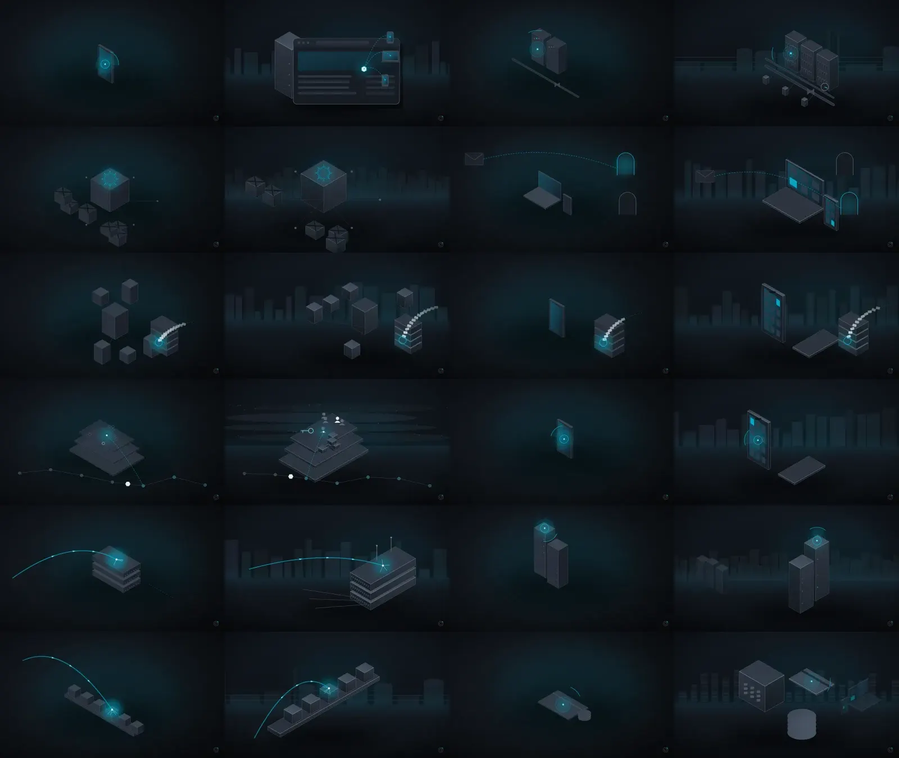
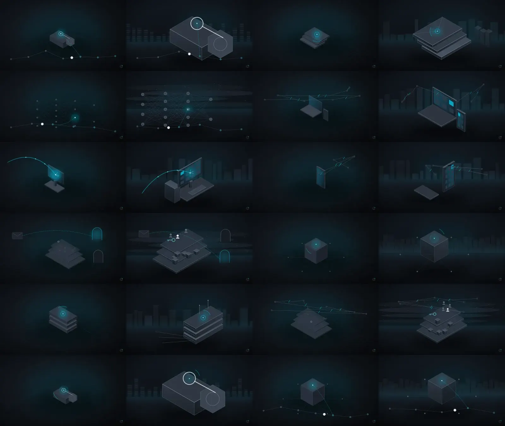
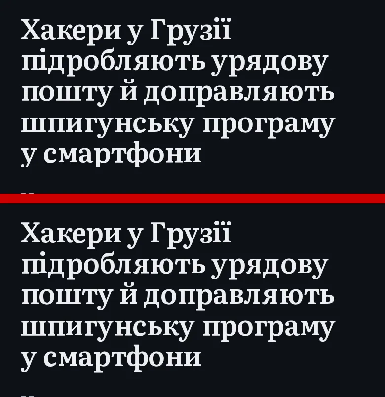
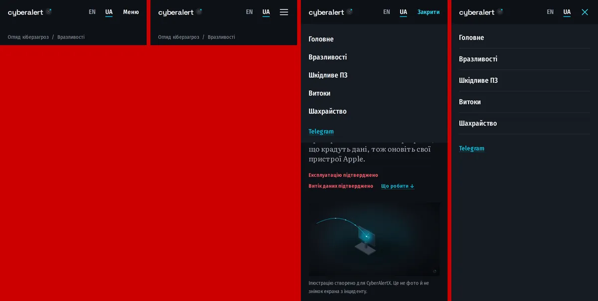

# Illustration review: renderer v2 (`cax-svg-2`)

All illustrations are **programmatic SVG** (`generation_method=svg`). They are
not produced by an AI image model. ComfyUI is not running on the production
host (audit on 5 Nov 2026: 131 of 131 production assets were `svg` /
`cax-svg-1`; nothing listens on its port).

## What changed

| v1 (`cax-svg-1`) | v2 (`cax-svg-2`) |
|---|---|
| Fixed small scale, subject floating in empty space | The scene is measured and fitted to fill 50–60% of the frame width (or 56–64% of its height) |
| The same perspective grid behind every image | A blurred far layer per technology family: datacenter rows, city network, industrial plant, cloud strata, finance towers |
| One scene only | The story's second technology appears as a dimmed, out-of-focus mid layer |
| Flat single-colour faces | Lit gradient materials, rim-lit edges, a contact shadow and a floor |
| Same camera for every story | Six seeded camera presets (placement, mirroring) and zoom |
| Large cyan glows | Glow reduced to 60% of its previous strength; light marks the subject |
| Sparse objects | Phones with app tiles, workstations with keyboard and tower, browser pages with layout blocks, edge appliances with port banks, PLC cabinets with DIN modules, a gauge and sensors, cloud layers with identities and an access key, a payment terminal with a card |

The event overlays (attack path only when exploitation is confirmed, records
leaving only when exposure is confirmed, and so on) and the sanitizer are
unchanged. Rendering takes about 0.04 s per image.

## Measured on 24 real stories (EN and UA)

"Visible content" is the share of the frame that is not near-black
background (luminance > 38/255, measured at 400×225). It is a proxy for
empty space, not for quality.

- Median visible content: **4.4% → 11.2%**. The lowest image went from 1.5% to 7.7%.
- All 24 compositions are distinct (alt text and framing). No asset is
  shared between stories (the dry-run checks this).
- Website payload per image: article 15 KB WebP / 10 KB AVIF, thumbnail
  6 KB. The Telegram PNG went from 168 KB to 105 KB.

Before (left) and after (right), 12 pairs per sheet:

| # | Story | Category | Lang | Type | Visible content | Now shows |
|---|---|---|---|---|---|---|
| 1 | APT29-Linked Hackers Hijack Web Analytics Script to Deliver iOS and Android Exploits | exploit | EN | svg (cax-svg-2) | 1.9% → 14.8% | a tampered third-party script spreading from a website to visitors' devices, with a web server and a site. |
| 2 | Cyberattack disrupts blood storage refrigeration systems in France | other | EN | svg (cax-svg-2) | 4% → 8.7% | an analytical cross-section of the mechanism, with industrial control equipment. |
| 3 | UK school estate hit by 3AM ransomware in suspected AI-assisted attack | ransomware | EN | svg (cax-svg-2) | 6.4% → 10.1% | systems sealed by ransomware. |
| 4 | росія атакувала Україну «шахедами-агітаторами», що несли листівки з QR-кодами та закликами «зупинити свавілля ТЦК» | phishing | UA | svg (cax-svg-2) | 4.9% → 11.2% | a deceptive message leading to a counterfeit gateway, with a home computer and phone. |
| 5 | DreamHost confirms data breach exposed FTP logins and webmail sessions | breach | EN | svg (cax-svg-2) | 8.3% → 10.7% | records leaving a breached archive, with a corporate network. |
| 6 | Злам застосунку "Повітряна тривога": робота поступово відновлюється після відключення | breach | UA | svg (cax-svg-2) | 4.4% → 10% | records leaving a breached archive, with a smartphone. |
| 7 | Vercel rolls out new protection against stolen session cookie attacks | malware | EN | svg (cax-svg-2) | 8.8% → 13% | a foreign component moving through the delivery chain, with cloud accounts and identity layers. |
| 8 | GhostMap Android flaw lets malicious app trigger persistent boot loop | vulnerability | EN | svg (cax-svg-2) | 1.9% → 9.6% | an exposed weak point, no attack shown, with a smartphone. |
| 9 | Zyxel fixes zero-day exploited to hack nearly 1,000 network switches | vulnerability | EN | svg (cax-svg-2) | 5.6% → 12.2% | attack path entering an exposed component, with network edge appliances. |
| 10 | OpenAI AI Pipeline Generates 948 Linux Root Escalation Exploits in 30-Hour Run | vulnerability | EN | svg (cax-svg-2) | 5.1% → 10.3% | an exposed weak point, no attack shown, with server racks. |
| 11 | CISA says max severity GitLab flaw now exploited in the wild | vulnerability | EN | svg (cax-svg-2) | 5% → 9.5% | attack path entering an exposed component, with a software build pipeline. |
| 12 | Fintech platform Sageworks taken offline after suspected cyberattack | other | EN | svg (cax-svg-2) | 3.2% → 12.5% | an analytical cross-section of the mechanism, with a payment flow. |
| 13 | NIKKE PC game launcher hacked to spread remote access, data-stealing malware | malware | EN | svg (cax-svg-2) | 3.8% → 19.5% | a foreign component moving through the delivery chain, with a cryptocurrency wallet. |
| 14 | The SOC Files 5: Ghost in the pipeline, or a fileless SharePoint breach by Storm-2603 | exploit | EN | svg (cax-svg-2) | 4% → 17.5% | an exposed weak point, no attack shown, with an email and collaboration system. |
| 15 | Полювання на токени: нові віруси-інфостілери викрадають акаунти ChatGPT, Claude та Copilot | malware | UA | svg (cax-svg-2) | 1.5% → 7.7% | a foreign component moving through the delivery chain, with an AI model network. |
| 16 | Police seizes over 100 servers in investment scam crackdown | scam | EN | svg (cax-svg-2) | 4.3% → 13.9% | dismantled attacker infrastructure, with a home computer and phone. |
| 17 | Hackers Exploit Patched Apple Flaw to Deliver Info-Stealing Malware, CISA Says | vulnerability | EN | svg (cax-svg-2) | 4% → 12.3% | attack path entering an exposed component, with a desktop computer. |
| 18 | Tech Firms Dismantle Botnet That Turned 1.3M TV Boxes Into Proxies | botnet | EN | svg (cax-svg-2) | 2% → 9.3% | dismantled attacker infrastructure, with a smartphone. |
| 19 | Google Warns LLMjacking Attacks Are Costing Some Enterprises Up to $1 Million in Cloud Charges | phishing | EN | svg (cax-svg-2) | 9.3% → 18% | a deceptive message leading to a counterfeit gateway, with cloud accounts and identity layers. |
| 20 | Один хакер за допомогою мережі з 12 ШІ-агентів атакував об'єкти в 11 країнах світу | other | UA | svg (cax-svg-2) | 3.7% → 8.4% | an analytical cross-section of the mechanism. |
| 21 | SonicWall Won't Patch EoL GMS Flaws That Could Expose Files, Alter Database Records | vulnerability | EN | svg (cax-svg-2) | 5.4% → 11% | an exposed weak point, no attack shown, with network edge appliances. |
| 22 | Google Calendar phishing campaign hijacks sessions, bypasses MFA | phishing | EN | svg (cax-svg-2) | 9.2% → 13.7% | dismantled attacker infrastructure, with cloud accounts and identity layers. |
| 23 | Binance розкрила, як хакери проникли в систему через фальшиві співбесіди та AI-інструмент | other | UA | svg (cax-svg-2) | 3% → 19.1% | an analytical cross-section of the mechanism, with a cryptocurrency wallet. |
| 24 | Hackers hijack cPGuard autoupdate to deploy backdoor, steal data | malware | EN | svg (cax-svg-2) | 4.6% → 8.6% | a foreign component moving through the delivery chain. |

## Limits

- This is still an isometric, programmatic style, not cinematic 3D
  rendering. Detail is higher, but some overlays, such as the malware
  delivery chain, still look alike across stories of the same category.
- "Visible content" counts pixels. Whether a reader recognises the subject
  without the title was judged by eye on these sheets, not measured.

## Rollout

`tools.media backfill` (dry-run) on a copy of production data:
- 130 public stories;
- 129 to replace because of the renderer upgrade (`cax-svg-1 -> cax-svg-2`)
  and 1 with no image yet;
- 0 assets shared between stories;
- about 6.5 CPU seconds and about 1.4 MB of disk, cost 0.

On a staging copy, all 130 were regenerated in 4.9 s at 97 MB peak memory.
After deployment the hourly media pass replaces 25 per run. Run
`tools.media backfill --batch 130` to replace them all at once. Asset ids,
and so article and Telegram associations, do not change; only the file does.

## Typography and mobile navigation (same PR)

**Clipped descenders.** The article headline used the `reveal` animation,
whose last keyframe was `clip-path: inset(0)` with `animation-fill-mode:
both`. The clip stayed applied after the animation and cut everything below
the line boxes: g, y, у, р, ф on the last line, at line-height 1.12. The clip
box now extends past the glyphs, and the animation no longer persists
(`backwards`). The e2e test `typography-nav.spec.ts` checks EN and UA titles
ending in descenders at 375, 390, 430, 768, 1280, 1440 and 1920 px. It
fails against the old CSS with `clip-path inset(0px 0px 0%)` and passes
with the fix.

**Mobile menu.** The "Меню / Закрити" text became a 44×44 hamburger that
turns into an X. Its labels are «Відкрити/Закрити меню навігації» and "Open/Close
navigation menu". It opens a full-height graphite panel below the header:
- page scrolling is locked;
- focus moves into the panel;
- Escape and every link close it, and focus returns to the button.

Items and order are unchanged.

