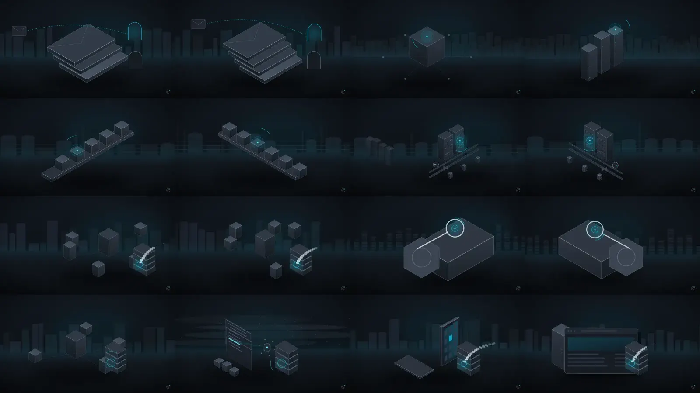
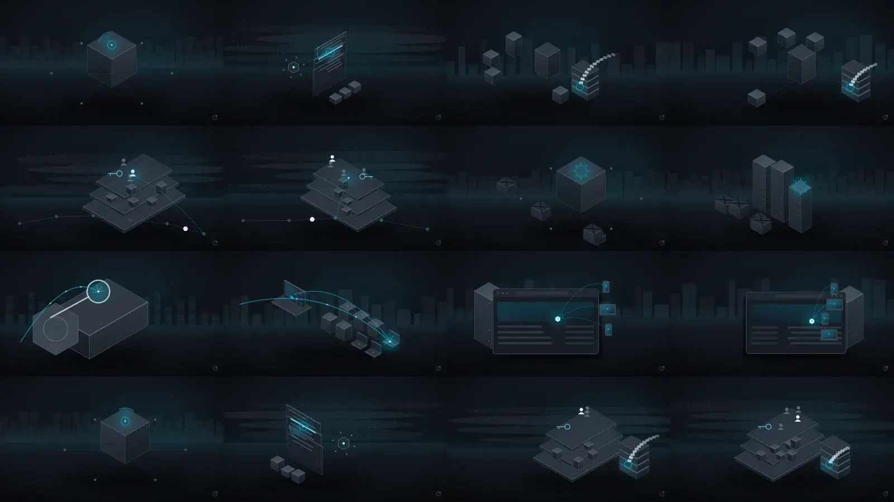
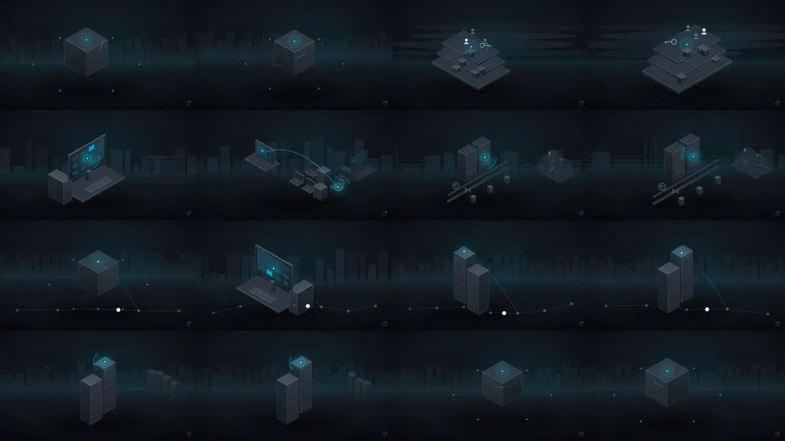
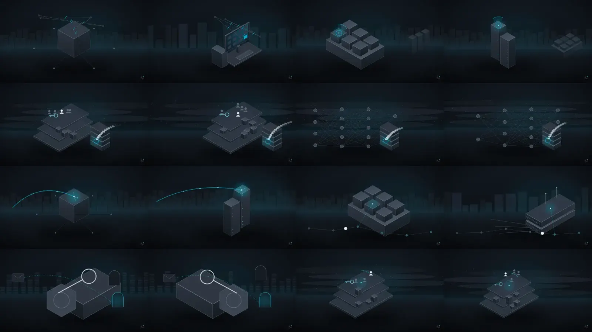

# Illustration review: renderer v3 (`cax-svg-3`)

Programmatic SVG, as before: not an AI model, no paid service. The VPS has
2 vCPU, 3.7 GiB RAM and no GPU (checked 17 Nov 2026), so local diffusion
remains out of reach.

## What changed and why

The generic images came mostly from **choosing the wrong subject**, not from
too little detail:

- scene rules matched any word anywhere in the headline, in a fixed rule
  order, so "… as attackers deploy **crypto** miners" made N-central a wallet;
- rules were English-only, so Ukrainian headlines fell through to an
  abstract cube;
- two frequent story types had no scene of their own: AI-driven
  vulnerability discovery and remote-management platforms.

v3 changes:

1. **Main clause first.** The headline is split at clause connectors (as,
   after, while, amid, following, після, через, на тлі). Rules apply to the
   main clause in order of mention; the rest only adds secondary scenes.
2. **Bilingual rules**, plus a server rule (servers, Linux, vCenter, IRC) and
   a data-centre rule (supercomputer, ЦОД).
3. **Fallbacks before the abstract core.** The source excerpt, then a category
   default (ransomware → server room, breach → corporate network, phishing →
   mail…). The cube remains only for pieces that name no technology at all.
4. **New scene families.**
   - `ai_discovery`: code panels, an analysis core and a scan beam on one
     component (AI with vulnerabilities, attacks or hacking in one clause).
   - `rmm`: an admin console with remote sessions to a fleet of managed
     machines.
5. **No 404s during a backfill.** A replaced image keeps its previous files
   servable (`previous_storage_keys`), so a cached page still pointing at the
   old file keeps working while it revalidates. Old files are never deleted.

Evidence gating and the sanitizer are unchanged: attack paths appear only
for confirmed exploitation, exfiltration only for confirmed exposure.

## 32 real stories (current → proposed)

The subject changed in 13 of 32 stories, and the abstract cube went from 8
stories to 2 (two opinion pieces naming no technology). All 32 get a new
composition, because the renderer version is part of the layout seed.

Each sheet shows the current image (left) and the proposed one (right) per
pair. The full gallery is built locally with titles, canonical story ids,
briefs, thumbnails and a reviewer checkbox per story.

| # | Story | Canonical story | Category | Lang | Was | Now (scene / event) |
|---|---|---|---|---|---|---|
| 1 | Inside Modern Phishing Kits Built to Steal Microsoft 365 Sessions | `s:74611fb5503115` | phishing | EN | an email and collaboration system | **mail** / phishing |
| 2 | Хакери атакували найпотужніший супер-ПК Японії: викрадено понад 4000 облікових записів | `s:bf9ab5763c6725` | other | UA | — | **server_room** / analysis |
| 3 | Hackers Found a Way Around GitHub SHA Pinning. This Webinar Explains How to Close the Gap | `s:2357990c49651d` | other | EN | a software build pipeline | **pipeline** / analysis |
| 4 | Siemens Industrial Software Products | `s:1d0989e61b167e` | vulnerability | EN | industrial control equipment | **industrial** / exposed |
| 5 | Хакер із Lapsus$, який злив 90 відео GTA VI, визнав провину — покарання оголосять 23 листо | `s:4d70c8439673e6` | breach | UA | a corporate network | **corporate** / breach_confirmed |
| 6 | Court clears brothers of $25 million Ethereum crypto heist charges | `s:c7473da0d0d7e7` | exploit | EN | a cryptocurrency wallet | **wallet** / exposed |
| 7 | ФБР попередило про загрозу: хакери використовують створений для кіберзахисту ШІ-інструмент | `s:e23fe718e34524` | breach | UA | a corporate network | **ai_discovery** / breach_unconfirmed |
| 8 | Сайти Zoom, Salesforce, IKEA та десятків інших компаній зламали для викрадення криптовалют | `s:e2a93178aacdf4` | breach | UA | a smartphone | **web** / breach_confirmed |
| 9 | Google заявила про ймовірно першу повністю автоматизовану кібератаку з використанням ШІ | `s:c742d5f040f946` | vulnerability | UA | — | **ai_discovery** / exposed |
| 10 | Uber notifies drivers of data breach affecting nearly 150,000 people | `s:cec351f707f475` | breach | EN | a corporate network | **corporate** / breach_confirmed |
| 11 | Operation ShadowCloud: cloud service–based backdoors targeting government networks in Asia | `s:fe8023ea6d9224` | malware | EN | cloud accounts and identity layers | **cloud** / malware |
| 12 | Ransomware affiliate suspect extradited to US, faces 27 years in prison | `s:9788728ba02c6d` | ransomware | EN | — | **server_room** / ransomware |
| 13 | N-able Patches 17 N-central Flaws as Attackers Exploit Earlier Bugs to Deploy Crypto Miner | `s:ae48d5d570f217` | exploit | EN | a cryptocurrency wallet | **rmm** / exploited |
| 14 | Optimizely supply chain attack infects major brands' sites with malware | `s:34d247dd30a5e5` | exploit | EN | a web server and a site | **web** / script_injection |
| 15 | Google Project Zero cuts bug disclosure deadline amid AI threats | `s:cfa2436a0cc05f` | exploit | EN | — | **ai_discovery** / exposed |
| 16 | Barracuda links cloud breach to ARTEX AI-powered cyberattack | `s:34c9b1e10f4726` | breach | EN | cloud accounts and identity layers | **cloud** / breach_confirmed |
| 17 | Зниження ризиків та стабільність зв'язку: у Huawei поділилися досвідом захисту телеком-інф | `s:a2cef9385d9d05` | other | UA | — | **core** / analysis |
| 18 | 7 Tips For Complying with CJIS Password and MFA Requirements | `s:4920ea37689ed6` | other | EN | cloud accounts and identity layers | **cloud** / analysis |
| 19 | ⚡ Weekly Recap: N-able 0-Days, Windows 0-Days, Chrome 0-Days, Fridge 0-Days, and More Bad  | `s:9b59539c3de141` | zero-day | EN | a desktop computer | **rmm** / exposed |
| 20 | Six Unpatched Danfoss Refrigeration Controller Flaws Could Allow Remote Takeover Without L | `s:d58c851f788c14` | vulnerability | EN | industrial control equipment | **industrial** / exposed |
| 21 | Retadup Worm Resurfaces 7 Years After Takedown to Spread CoffeeLoader Malware | `s:ac45b5eb67e9e9` | malware | EN | — | **workstation** / malware |
| 22 | SANSAR Linux Cryptomining Malware Uses Modified NVIDIA Library to Hide GPU Activity | `s:b80e4acc50a176` | malware | EN | server racks | **rack** / malware |
| 23 | New NoisyTCP vulnerability lets attackers crash Linux servers | `s:84d77f31fcca9f` | vulnerability | EN | server racks | **rack** / exposed |
| 24 | Кібербезпека — це не лише питання IT: що потрібно знати у 2027 році | `s:43f11f47ce36ad` | other | UA | — | **core** / analysis |
| 25 | A USB worm’s second life: Retadup spreading CoffeeLoader | `s:07d1a69da469de` | malware | EN | — | **workstation** / disrupted |
| 26 | BO Team Exploits Log4Shell in VMware vCenter, Compromises Russian Firm's Code-Signing Serv | `s:7798b273f81418` | exploit | EN | a virtualisation host | **rack** / exposed |
| 27 | TSMC employee data breach linked to cloud provider | `s:97f0ab1eb12049` | breach | EN | cloud accounts and identity layers | **cloud** / breach_confirmed |
| 28 | Stolen Fireworks AI Key Led to Cursor Data Breach and Trojanized Claude Code Extension | `s:69560c1110e62b` | breach | EN | an AI model network | **ai** / breach_confirmed |
| 29 | Attackers Exploit UnrealIRCd Flaw That Enables Server-Level Command Injection | `s:03d10b5fae4006` | vulnerability | EN | — | **rack** / exploited |
| 30 | Check Point gateways hacked via PHP2Shell to deploy VMware ESXi wiper | `s:779ad569e52c2d` | malware | EN | a virtualisation host | **network_edge** / malware |
| 31 | FBI Says North Korean Hackers Stole Over $400 Million in Crypto Using Deepfake Video Calls | `s:31008e64145065` | social engineering | EN | a cryptocurrency wallet | **wallet** / phishing |
| 32 | Self-hosted чи SaaS: коли українському бізнесу вигідніше контролювати власні інструменти | `s:9458617157ad9a` | other | UA | cloud accounts and identity layers | **cloud** / analysis |

## Limits, stated plainly

- The style is still isometric and programmatic. Stories whose subject was
  already right get a new layout but no better drawing. This is not
  cinematic art direction.
- Scene choice is keyword-based on the canonical story's anchor headline and
  excerpt; an unusual phrasing can still pick a secondary subject.
- Recognisability without the headline was judged by eye on these sheets, not
  measured.

## Backfill (not run)

Deploying v3 does **not** replace existing images. The hourly media pass keeps
every validated image made by an older renderer and draws only new stories,
or redraws a story whose facts changed. Replacing the archive is only ever the
explicit `backfill --batch` step.

`tools.media backfill` dry-run on live data, 17 Nov 2026:
- 143 eligible public stories;
- 143 to replace (renderer `cax-svg-2` → `cax-svg-3`);
- no assets shared between stories;
- about 7 CPU-seconds and 3.4 MB, at no cost.

It runs only after this gallery is approved, as a separate step:
`tools.media backfill --batch 150` as `cax`, with the hourly media pass idle.
