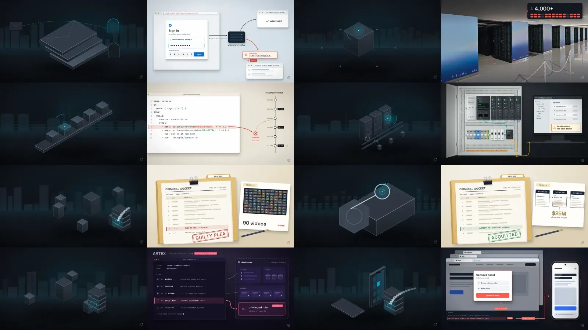
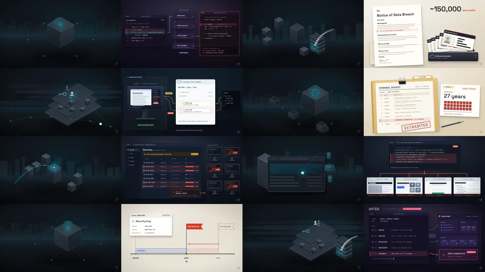
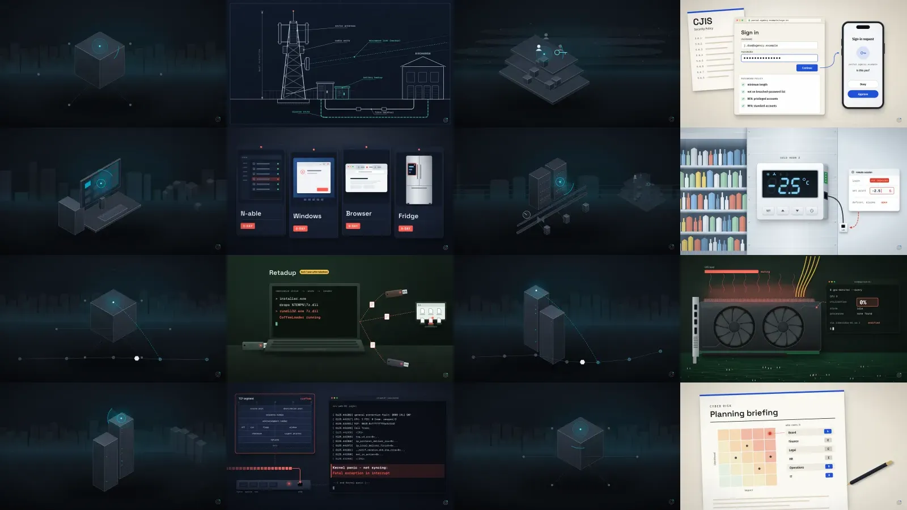
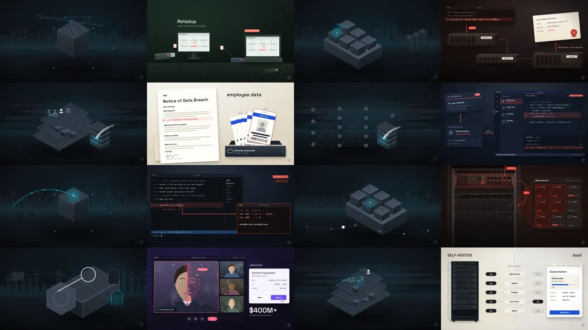

# Illustration review: V3 → V4 (`cax-editorial-4`)

The system itself is described in [VISUAL_SYSTEM_V4.md](VISUAL_SYSTEM_V4.md).
This document reports how it performed on real stories, what was fixed in
review, and what still needs a human eye.

**Status: candidate.** V4 is built, tested and on `main`, but production still
renders with V3. Nothing has been regenerated. Activation and the archive
backfill both need the owner's approval (see "Activation").

## The review set

The review set is the same 32 stories as the V3 review, so the two can be
compared directly, plus 4 supplementary stories. The 32 include the three
named examples: Fugaku, GitHub SHA pinning and Microsoft 365 session phishing.
The supplementary 4 show the two scenes the archive actually uses most:
`vuln_advisory` (35 of 152 eligible stories) and the `dossier` fallback (27 of
152). The full gallery is kept on the host at
`$REVIEW_DIR/illustrations-v4/index.html`, built by
`ops/media/build_review_gallery.py`. For every story it shows:

* the headline and story ID;
* the structured brief and why the scene was chosen;
* V3 and V4 side by side, with full-size links;
* the real 176 px feed thumbnail, using the site's crop rules;
* the chat-preview size;
* source and licence;
* uncertainty, scores and cost.

| | |
|---|---|
|  |  |
|  |  |

Each pair shows V3 on the left and V4 on the right.

## Scores

The scores come from looking at the rendered PNGs at full size and at feed
size, not from reading code. Each criterion is scored 1–5.

| Criterion | 32 stories | All 36 |
|---|---|---|
| Story relevance | 4.84 | 4.69 |
| Recognition without the headline | 4.25 | 4.17 |
| Visual quality | 4.03 | 4.00 |
| Composition | 3.88 | 3.89 |
| Distinctiveness | 4.12 | 4.00 |
| Technical accuracy | 4.22 | 4.28 |
| Source rights | 5.00 | 5.00 |

For comparison, V3 at its best had subject changes in 13 of 32 stories, and 2
of them still fell back to a generic cube. In V4, every one of the 32 stories
gets a scene that depicts its own subject. None of them uses the fallback.

## Fixed during the review

| Story | Problem found by looking at the image | Fix |
|---|---|---|
| Siemens industrial software | The screen showed ladder logic, but the advisory concerns Industrial Edge management apps | The workstation shows the edge device list for that advisory |
| ARTEX (FBI warning, Barracuda breach) | Read as a generic task list, and the two stories looked the same | The tool identity is set out: "ARTEX: security-testing tool → run against a real target". The Barracuda variant ends in "data copied out" |
| Telegram RCE claims (supplementary) | Stamped **EXPLOITED**, although the sources report a researchers' claim | Shown as **PROOF OF CONCEPT** unless use in the wild is reported (regression test) |
| Fugaku "taken offline" (archive) | The photo annotation claimed stolen accounts, which that story does not state | The annotation follows the story: account figure, **OFFLINE**, or **BREACH**. The alt text matches |
| Dossier fallback | Printed our internal story key on a public image | Replaced with a neutral seeded file number |
| Scene routing | "Linux" alone sent a GSocket backdoor story to the kernel-crash scene | A scene must match its primary pattern. Weak support (excerpt only) goes to the restrained fallback |
| Facts | "37.6M records" became "37.6", and "4000 облікових записів" also counted as records | Scale units are kept, and account counts are no longer double-counted |

## Still needs human review (scored below 4 on relevance, recognition, quality or accuracy)

Updated 18 Nov: #28, #29 and #34 were fixed after the review, and their images were re-inspected at full size and at 176 px.

| # | Story | Score below 4 | What to fix |
|---|---|---|---|
| 28 | Stolen Fireworks AI key → Cursor breach → trojanised Claude Code extension | ~~accuracy 3~~ → **fixed** | The invented loader code, `curl \| sh` process, key scope, "auto-update" and "restart not required" were removed. The editor now shows the extension's update with its contents redacted as "not described in the reports"; only the key holder, the marketplace and the malicious version (all in the sources) remain |
| 29 | UnrealIRCd command injection | ~~accuracy 3~~ → **fixed** | No `;`, `sh -c` or `uid=` output. The crafted message marks an abstract delimiter token ("delimiter not neutralised"). The server panel states only "delimiter-handling flaw", "command executed by the IRC server" and "execution details not published" |
| 31 | North Korean deepfake video calls ($400M+) | visual quality 3 | The half-rendered face is flat, close to clip-art. The mesh idea works; the skin and hair rendering needs a better hand |
| 34 | Telegram RCE claims (supplementary, `vuln_advisory`) | ~~visual quality 3~~ → **improved** | The sparse terminal layout was replaced by a "spotlight" built for feed size: a full-height status panel (name, status band in the evidence colour, identifiers) and the product drawn large on a lit stage. Used for about a third of advisories (12 of 35 today). The sheet layout's thumbnail crop no longer cuts the product name |
| 35, 36 | Trigram campaign, Fandango checkout skimming (`dossier`) | relevance 3, recognition 3 | Restrained by design. Missing scenes would serve them and the other 25 dossier stories: payment skimmer, police takedown, IoT camera, crypto exchange theft, drone/defence, eBPF rootkit |

## Weaker but above the bar

* **Same layout within a scene.** The three court stories differ only in
  their exhibit and stamp. The two breach notices (Uber, TSMC) share the
  letter-and-cards layout. Distinctiveness is 3 for these.
* **Placeholders.** Commit hashes, block numbers, controller temperatures,
  file and process names are illustrative. Every number taken from a source
  comes from `brief.facts`.
* **Generic interfaces by design.** No vendor logos or interfaces appear (no
  Microsoft sign-in, no Apple phone, no NVIDIA mark), so recognition rests on
  the mechanism. Brand names appear only as plain text, and only where the
  headline names them.
* **Many dark interface scenes.** The software stories use the midnight
  palette. The light palettes (paper, glacier, court) carry most of the
  variety.
* **Fallback share.** Across the 152 eligible stories, 27 (18 %) fall back to
  `dossier` and 35 (23 %) get the generic `vuln_advisory`. These are honest
  but not story-specific. New scenes for the clusters listed above would cut
  this the most.

## Real photographs (Tier A)

One verified photograph so far: Fugaku in its machine hall (Wikimedia Commons,
CC0, the uploader's own work). The original's SHA-1 was checked against
Commons, and the plate's SHA-256 is pinned in the manifest. The crop is 16:9
and EXIF/GPS data is removed. Two archive stories name Fugaku and use it.

The library accepts only CC0 and public-domain photographs for now. The same
image goes to Telegram and Threads, which carry no credit line, so CC BY would
not be honoured there, and share-alike would bind our composites. The site
shows the credit under the article image anyway. Photographs are stored in the
repository and embedded in the SVG, never hotlinked.

Adding a photograph means:

1. Verifying the licence on its source page.
2. Recording provenance in `library/library.json`.
3. Committing the processed plate.

`library.validate` and the tests refuse anything incomplete.

## Cost and limits (measured on this host)

* **Rendering** takes 1–70 ms per image in Python (70 ms is a cold start; 3–40
  ms typically). SVG size is 24–179 KB; the Fugaku plate adds about 165 KB.
* **Rasterization** by the site's sharp takes 0.4–1.4 s per variant at
  1600×900. V3 takes about 0.4 s. About 0.3 s of the difference is the film
  grain filter. Variants are cached by the CDN for a day.
* **Backfill plan** (read-only, V4): 152 eligible stories, 152 to generate
  (144 currently V2, 8 V3), about 3.5 MB, cost $0.
* **Production runtime.** No new dependencies and no network calls. Fonts are
  vector outlines extracted once at development time
  (`ops/media/build_glyphs.py`, SIL OFL notices in `media/v4/fonts/`).

## Activation (needs approval)

The plan is in [V4_ACTIVATION_PLAN.md](V4_ACTIVATION_PLAN.md). It starts with a
canary on new stories only, with the archive untouched and checked, and gives
exact commands, rollback, and go/no-go criteria. The archive backfill is a
separate, later decision.

An earlier draft of this section described rollback as "unset the variable
and run the backfill again". That is wrong for the current archive, where 302
of 313 images are `cax-svg-2`: the backfill would convert them all to V3.
Rollback re-renders only the V4 images, story by story.
